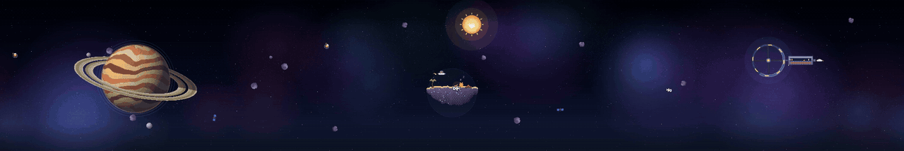
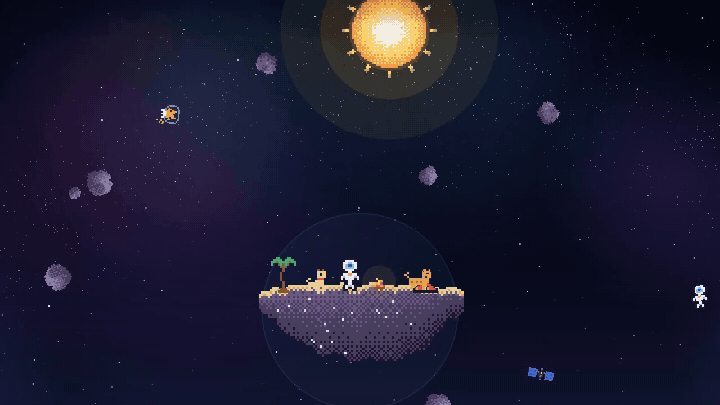
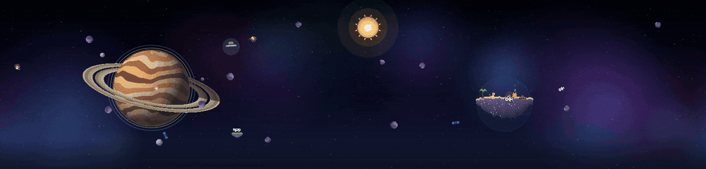

# Cosmos

**Una escena espacial viva en pixel art para [Omarchy](https://omarchy.org), que recorre todos tus monitores como un
solo panorama.**

[English](README.md)



Una sola simulación mueve todas las pantallas. Rocas, gatos espaciales, satélites y cometas conservan su impulso al
pasar de un monitor a otro y se curvan con la gravedad del planeta. Un astronauta náufrago vive en una isla flotante con
un gato y un perro. Cada pocos minutos ocurre una historia corta en algún punto del panorama: hay 107.



## Instalación

```bash
omarchy plugin add https://github.com/lnavarrocarter/omarchy-cosmos --enable
```

Cuando pregunte dónde poner el widget de la barra, elige una sección u omítelo: la escena no lo necesita.

Para el aspecto completo (paleta, bordes de nebulosa, animaciones y vidrio esmerilado), instala también el tema:

```bash
omarchy theme install https://github.com/lnavarrocarter/omarchy-cosmos-theme
```

La escena se dibuja en la capa del escritorio, bajo tus ventanas, y deja pasar los clics al escritorio.

**Requisitos.** Omarchy 4 (probado en 4.0.0-alpha), Hyprland y `python3`. Opcional: `nvidia-smi` o una GPU AMD para
leer el uso de la GPU.

**Actualizar y quitar.**

```bash
omarchy plugin update lnavarrocarter.cosmos
omarchy plugin remove lnavarrocarter.cosmos
```

## Qué hay en pantalla

Las zonas se asignan a los monitores de izquierda a derecha:

| Monitores | Zonas |
| --- | --- |
| 1 | la isla |
| 2 | planeta, isla |
| 3 | planeta, isla, estación |
| 4 o más | planeta, isla al centro, estación en el último y cielo abierto entre medio |

- **Planeta**: un gigante gaseoso con anillos y lunas en órbita.
- **Isla**: el astronauta, el gato y el perro se turnan en escenas: pescan estrellas, saludan a un transbordador,
  duermen junto al fuego, el gato persigue un pez, miran las estrellas.
- **Estación**: una rueda que gira y un hábitat con tripulación que pasa por las ventanas. De vez en cuando atraca un
  transbordador.

Cada episodio solo ocurre donde existe su zona: con una pantalla verás los de la isla y los del cielo.
Para dejar Cosmos solo en algunos monitores, ponlos en `monitors`.



### Episodios

107 historias cortas:

- Un ovni abduce una vaca.
- El perro se escapa a pelear contra piratas mientras el astronauta duerme.
- Una pizza llega en scooter.
- Una ballena, un dragón, un pato de goma gigante.
- Un agujero de gusano, un eclipse de verdad, luciérnagas que forman la hora.

Algunas dependen de la fecha o de la hora: un trineo en diciembre, un barco fantasma en octubre, fuegos artificiales en
Año Nuevo, cueca para el 18, un gallo al amanecer.

El escenario participa: el viento dobla la palmera y las ventanas de la estación se ponen en modo fiesta.

- **Haz clic** en la isla para un episodio al azar, o en el perro, el gato o el astronauta para una reacción suya.
- **Arrastra** una roca y lánzala: mantiene la velocidad del puntero hasta que la gravedad y el roce la frenan.
- **Tu computador** cambia el clima:
  - la CPU trae tormentas al planeta;
  - la RAM espesa el campo de asteroides;
  - la GPU acelera la rueda de la estación.
- **Ciclo del día**: el sol cruza el panorama entre `sunrise` y `sunset`, y de noche la luna muestra su fase real. Cada
  hora pasa un cohete con la hora.
- **Salvapantallas**: después del tiempo `idle.screensaver` de Omarchy, la escena cubre todas las pantallas con un reloj
  y los episodios se encadenan.
  - El salvapantallas de terminal de Omarchy aparece al mismo tiempo. Apágalo con `omarchy toggle screensaver` si
    prefieres Cosmos.
  - Para verlo ahora: `omarchy-shell lnavarrocarter.cosmos preview`.

## Cosmos Studio: hazlo tuyo

Haz clic derecho en el widget de la barra, o ejecuta `omarchy-shell lnavarrocarter.cosmos studio`. Se abre una tarjeta
sobre la escena en vivo, y cada cambio se ve en el momento:

- **Escena**: activa o desactiva cada animación (episodios, cometas, warp, sol y luna, el cohete de la hora, lanzar
  rocas, clima), cada cuánto hay episodios, cuántas rocas, gatos y satélites flotan, el salvapantallas y los cuadros por
  segundo.
- **Casa y planeta**: dónde vive el náufrago (una isla, un planetoide con casita y árbol, un castillo flotante o una
  nave) y el planeta: nueve estilos (con anillos, tormenta, amatista, hielo, lava, océano, desierto, tóxico, cristal),
  anillos sí o no, o **uno creado desde tu propia descripción**.
- **Personajes**: colores del traje, visor y detalle del astronauta, del gato, del perro y del transbordador. Los
  episodios también los usan.
- **Flota**: la flota de agentes opcional y los colores de sus naves.

### Planetas desde una descripción

Escribe algo como "un mundo helado azul con anillos rosados" y presiona *Crear planeta*, o ejecuta
`omarchy-shell lnavarrocarter.cosmos planet "un mundo helado azul con anillos rosados"`. El modelo solo elige
parámetros (estilo, colores, anillos, un nombre); Cosmos dibuja el pixel art y revisa cada valor antes de usarlo.
Motores, del mejor al más simple:

| Motor | Qué necesita | Privacidad |
| --- | --- | --- |
| Claude | activarlo en el Studio, `pip install anthropic` y una clave en `ANTHROPIC_API_KEY`, `~/.config/cosmos/anthropic-key` o un perfil de `ant auth login` | la descripción se envía a Anthropic |
| Ollama | un [Ollama](https://ollama.com) local con cualquier modelo (`ai.ollamaUrl`, `ai.ollamaModel`) | queda en tu computador |
| Intérprete incluido | nada: entiende colores, estilos y anillos en español e inglés | queda en tu computador |

"El mejor disponible" los prueba en ese orden; Claude queda apagado hasta que lo actives.

## Comandos

```bash
omarchy-shell lnavarrocarter.cosmos episodes            # lista los episodios
omarchy-shell lnavarrocarter.cosmos episode <id|random> # reproduce uno ahora
omarchy-shell lnavarrocarter.cosmos click dog           # dog, cat o astronaut
omarchy-shell lnavarrocarter.cosmos event idle          # simula un evento (ver abajo)
omarchy-shell lnavarrocarter.cosmos rocket              # lanza el cohete de la hora
omarchy-shell lnavarrocarter.cosmos preview             # vista del salvapantallas (stop la termina)
omarchy-shell lnavarrocarter.cosmos showcase 60         # la escena sobre tus ventanas, sin reloj, para grabar
omarchy-shell lnavarrocarter.cosmos status              # versión, zonas, lecturas y opciones
omarchy-shell lnavarrocarter.cosmos studio              # abre o cierra Cosmos Studio
omarchy-shell lnavarrocarter.cosmos studioTab world     # lo abre en una pestaña: scene, world, crew, fleet
omarchy-shell lnavarrocarter.cosmos planet "<palabras>" # crea un planeta desde una descripción
```

## Configuración

El Studio cubre casi todo. Todo se guarda en `~/.config/cosmos/config.json`, fuera de la carpeta del plugin: las
actualizaciones y reinstalaciones no lo tocan, y los cambios se aplican al guardar. `config.example.json`, en el plugin,
lista todas las claves. (Las versiones anteriores guardaban un `config.json` en la carpeta del plugin; al iniciar se
copia al lugar nuevo.)

| Clave | Qué hace |
| --- | --- |
| `enabled` | apaga la escena sin quitar el plugin |
| `fps` | frecuencia de dibujo, 10–144 (30 usa la mitad de CPU) |
| `bezelGap` | píxeles de mundo oculto entre monitores, para que el movimiento calce con los marcos |
| `verticalOffsets` | desplazamiento vertical por monitor en px, por ejemplo `{"DP-2": 40}` |
| `zones` | zona por monitor (`planet`, `castaway`, `station`, `void`), por ejemplo `{"HDMI-A-1": "station"}` |
| `monitors` | solo estos monitores muestran Cosmos, por ejemplo `["DP-2"]`; vacío significa todos (las zonas siguen a los de la lista) |
| `rocks`, `cats`, `tourists`, `satellites` | cuántos cuerpos flotan |
| `comets`, `cometEvery` | cometas sí o no, y su intervalo en segundos |
| `sceneSeconds` | duración mínima y máxima de cada escena de la isla |
| `pauseOnFullscreen` | oculta la escena bajo ventanas a pantalla completa; pausa si todas las pantallas tienen una |
| `seed` | cambia la disposición inicial |
| `weather`, `weatherSeconds` | lecturas de CPU, RAM y GPU, y cada cuánto se toman |
| `dayCycle`, `sunrise`, `sunset` | sol y luna; horas como `"HH:MM"` (por defecto 06:35 y 20:40) |
| `hourlyRocket` | un cohete cada hora |
| `warp` | las estrellas se estiran al cambiar de escritorio |
| `screensaver`, `marathon` | la escena como salvapantallas; episodios seguidos mientras se muestra |
| `episodes`, `episodeEvery` | episodios al azar y su intervalo en segundos (por defecto 120–300) |
| `eventEpisodes`, `idleSeconds` | episodios que responden a eventos; segundos sin actividad para contar como ausente |
| `specialDates` | tus fechas, por ejemplo `{"birthday": "05-14"}` (ese día aparece un episodio) |
| `throwRocks` | las rocas se pueden arrastrar y lanzar |
| `look` | colores (`astronaut`, `cat`, `dog`, `shuttle`, `ships`), `home` (`island`, `planetoid`, `castle`, `ship`) y `planet` (un `preset`, o `style`, `colors`, `rings`, `ringColors`…) |
| `ai` | planetas desde una descripción: `engine` (`auto`, `ollama`, `claude`, `offline`), `claude` (permitido o no), `ollamaUrl`, `ollamaModel`, `claudeModel` |

Eventos que disparan episodios:

- `idle`: te alejas;
- `back`: vuelves;
- `cpuSpike`: la CPU pasa del 85 %;
- `hour`: cada hora en punto;
- `clickDog`, `clickCat`, `clickAstronaut`: clics en los personajes.

Con la flota de agentes encendida, también `taskDone`, `taskFailed`, `needsInput` y `prompt`.

## Opcional: flota de agentes

Viene apagada. Con `"fleet": true` la estación se vuelve la base de tus agentes de programación con IA (Claude Code,
Codex, Copilot y un modelo local). Cada uno tiene un hangar, una nave y un estanque de combustible según `budgets`, su
presupuesto diario de tokens.

- Cada prompt que envías lanza un explorador que cruza las pantallas.
- Los episodios responden al trabajo de tus agentes: confeti cuando una tarea termina, el perro repara una nave cuando
  una falla, un signo de pregunta cuando un agente te espera.
- El widget de la barra muestra una luz de la flota y el combustible de cada agente.

**Qué lee.** `fleet_probe.py` lee solo números: los tokens del día y la hora de los prompts en los registros de Claude
Code (`~/.claude/projects`) y Codex (`~/.codex/sessions`). Nunca lee el texto de prompts ni respuestas. Su caché queda
en `~/.cache/cosmos/`. Nada sale de tu computador.

`"hub": true` también lee las tareas del plugin Coordination (`local.coordination`) si está instalado. Al hacer clic en
una nave se abre ese plugin.

| Clave | Qué hace |
| --- | --- |
| `fleet`, `hub` | muestra la flota; lee las tareas del Hub |
| `fleetSeconds` | cada cuánto se consulta |
| `interactiveSeconds` | qué tan reciente debe ser el uso de la CLI para que una nave patrulle |
| `budgets` | presupuesto diario de tokens por agente, por ejemplo `{"claude": 5000000}` |
| `projectMoons`, `maxMoons` | una luna por proyecto, si el plugin Workbench (`local.workbench`) está instalado |

## Crea tus episodios

Los episodios son datos: cada pack en `episodes/*.js` describe actores que siguen trayectorias con keyframes, además de
partículas, disparos, cuerdas y rayos, y cuándo puede ocurrir cada episodio.

- **`EPISODES.md`** explica el formato y lista el catálogo.
- `node tools/storyboard.js <id> salida.png [tiempos…]` dibuja momentos de un episodio en un PNG, para revisarlo sin
  mirar el escritorio.

## Desarrollo

```bash
node --test "tests/*.test.js"                       # motor, física y todos los episodios de todos los packs
python3 -m unittest discover -s tests    # probes
omarchy plugin validate .
```

Después de editar QML ejecuta `omarchy restart shell`: la recarga en caliente no siempre recrea los plugins de servicio.

## Licencia

[MIT](LICENSE) © lnavarrocarter
