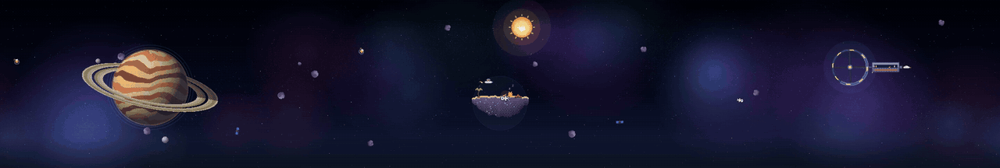
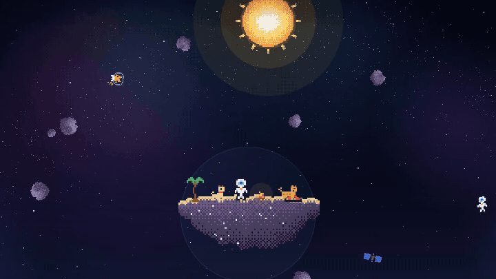
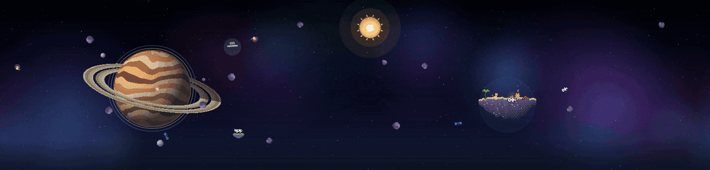

# Cosmos

**A living pixel-art space scene for [Omarchy](https://omarchy.org), spanning every monitor as one panorama.**

[Español](README.es.md)



One simulation drives every screen. Rocks, space cats, satellites and comets keep their momentum as they cross from one
monitor to the next and bend around the planet's gravity. A castaway astronaut lives on a floating island with a cat and
a dog. Every few minutes a short story plays somewhere in the panorama: there are 107 of them.



## Install

```bash
omarchy plugin add https://github.com/lnavarrocarter/omarchy-cosmos --enable
```

When you are asked where to put the bar widget, pick a section or skip it; the scene does not need it.

For the matching look (palette, nebula window borders, motion and frosted glass), install the theme too:

```bash
omarchy theme install https://github.com/lnavarrocarter/omarchy-cosmos-theme
```

The scene draws on the desktop layer, under your windows, and lets clicks through to the desktop.

**Requirements.** Omarchy 4 (tested on 4.0.0-alpha), Hyprland, `python3`. Optional: `nvidia-smi` or an AMD GPU for GPU
readings.

**Update and remove.**

```bash
omarchy plugin update lnavarrocarter.cosmos
omarchy plugin remove lnavarrocarter.cosmos
```

## What's on screen

Zones are assigned to monitors from left to right:

| Monitors | Zones |
| --- | --- |
| 1 | the island |
| 2 | planet, island |
| 3 | planet, island, station |
| 4 or more | planet, island in the middle, station on the last one, open sky in between |

- **Planet**: a ringed gas giant with orbiting moons.
- **Island**: the astronaut, the cat and the dog take turns at vignettes: fishing for stars, waving at a passing shuttle,
  sleeping by the fire, the cat chasing a fish, stargazing.
- **Station**: a turning wheel and a habitat whose crew walk past the windows. A shuttle docks now and then.

Episodes only play where their zone exists, so with one screen you get the island and sky stories.
To keep Cosmos on some monitors only, list them in `monitors`.



### Episodes

107 short stories:

- A UFO abducts a cow.
- The dog sneaks out to fight pirates while the astronaut sleeps.
- Pizza delivery by scooter.
- A whale, a dragon, a giant rubber duck.
- A wormhole, a real eclipse, fireflies that spell the time.

Some depend on the date or time of day: a sleigh in December, a ghost ship in October, fireworks on New Year's Eve, a
rooster at dawn.

The scenery joins in: wind bends the palm, the station's windows throw a party.

- **Click** the island for a random episode, or click the dog, the cat or the astronaut for one of their own reactions.
- **Drag** a drifting rock and throw it: it keeps your pointer's speed until gravity and drag take over.
- **Your computer** stirs the weather:
  - CPU brings storms to the planet;
  - RAM thickens the asteroid field;
  - GPU spins the station's wheel.
- **Day cycle**: the sun crosses the panorama between `sunrise` and `sunset`, and the moon shows its real phase at night.
  A rocket crosses every hour with the time.
- **Screensaver**: after Omarchy's `idle.screensaver` delay, the scene covers every screen with a clock, and episodes
  play back to back.
  - Omarchy's own terminal screensaver runs at the same moment. Turn it off with `omarchy toggle screensaver` if you
    prefer Cosmos.
  - Preview it with `omarchy-shell lnavarrocarter.cosmos preview`.

## Cosmos Studio: make it yours

Right-click the bar widget, or run `omarchy-shell lnavarrocarter.cosmos studio`. A card opens over a live view of the
scene, and every change shows as you make it:

- **Scene**: turn each animation on or off (episodes, comets, warp, sun and moon, the hourly rocket, throwing rocks,
  weather), how often episodes play, how many rocks, cats and satellites drift by, the screensaver and the frame rate.
- **Home, station & planet**: where the castaway lives (an island, a tiny planet with a house and a tree, a floating
  castle or a starship); the space station (classic, a big turning **torus**, a **spire** with solar wings and a hangar,
  or a hexagonal **citadel**), each with shuttles that come and go and crew on spacewalks; and the planet: ten presets
  (ringed, storm, amethyst, ice, lava, ocean, desert, toxic, crystal, and **Broken Forge**, a machine world with an
  artificial broken ring, satellites, stations, motherships, a space elevator, ring turrets that shoot scrap down, and
  chunks of crust that tear off at the fissures and spill their seas), rings on or off, or **one made from your own
  description**.
- **Characters**: colours for the astronaut's suit, visor and accent, the cat, the dog and the shuttle. Episodes use
  them too.
- **Fleet**: the optional agent fleet and its ship colours.

### Planets from a description

Write something like "a frozen blue world with pink rings" and press *Create planet*, or run
`omarchy-shell lnavarrocarter.cosmos planet "a frozen blue world with pink rings"`. The model only chooses parameters
(style, colours, rings, a name); Cosmos draws the pixel art, and every value is checked before it is used. Engines, best
first:

| Engine | What it needs | Privacy |
| --- | --- | --- |
| Claude | turned on in the Studio, `pip install anthropic`, and a key in `ANTHROPIC_API_KEY`, `~/.config/cosmos/anthropic-key` or an `ant auth login` profile | the description is sent to Anthropic |
| Ollama | a local [Ollama](https://ollama.com) with any model (`ai.ollamaUrl`, `ai.ollamaModel`) | stays on your computer |
| Built-in reader | nothing: it understands colours, styles and rings in English and Spanish | stays on your computer |

"Best available" tries them in that order; Claude is off until you turn it on.

## Commands

```bash
omarchy-shell lnavarrocarter.cosmos episodes            # list episode ids
omarchy-shell lnavarrocarter.cosmos episode <id|random> # play one now
omarchy-shell lnavarrocarter.cosmos click dog           # dog, cat or astronaut
omarchy-shell lnavarrocarter.cosmos event idle          # simulate an event (see below)
omarchy-shell lnavarrocarter.cosmos rocket              # launch the hourly rocket now
omarchy-shell lnavarrocarter.cosmos preview             # screensaver preview (stop to end)
omarchy-shell lnavarrocarter.cosmos showcase 60         # scene over your windows, no clock, for recording
omarchy-shell lnavarrocarter.cosmos status              # version, zones, readings, options
omarchy-shell lnavarrocarter.cosmos studio              # open or close Cosmos Studio
omarchy-shell lnavarrocarter.cosmos studioTab world     # open it at a tab: scene, world, crew, fleet
omarchy-shell lnavarrocarter.cosmos planet "<words>"    # create a planet from a description
```

## Configuration

The Studio covers most of it. Everything is saved in `~/.config/cosmos/config.json`, outside the plugin folder, so
updates and reinstalls never touch it and edits apply on save. `config.example.json` in the plugin lists every key.
(Older versions kept a `config.json` in the plugin folder; it is copied to the new place on first start.)

| Key | Meaning |
| --- | --- |
| `enabled` | turn the scene off without removing the plugin |
| `fps` | visual update rate, 10–144 (30 halves the CPU use) |
| `bezelGap` | pixels of hidden world between monitors, so motion lines up across bezels |
| `verticalOffsets` | per-monitor vertical shift in px, e.g. `{"DP-2": 40}` |
| `zones` | per-monitor zone (`planet`, `castaway`, `station`, `void`), e.g. `{"HDMI-A-1": "station"}` |
| `monitors` | only these monitors show Cosmos, e.g. `["DP-2"]`; empty means all (zones follow the ones listed) |
| `rocks`, `cats`, `tourists`, `satellites` | how many drifting bodies |
| `comets`, `cometEvery` | comets on or off, and their interval range in seconds |
| `sceneSeconds` | min and max length of each island vignette |
| `pauseOnFullscreen` | hide the scene under fullscreen windows; pause when every screen has one |
| `seed` | changes the starting layout |
| `weather`, `weatherSeconds` | CPU, RAM and GPU readings, and how often to take them |
| `dayCycle`, `sunrise`, `sunset` | sun and moon; times as `"HH:MM"` (default 06:35 and 20:40) |
| `hourlyRocket` | a rocket every hour |
| `warp` | stars streak when you switch workspace |
| `screensaver`, `marathon` | the scene as screensaver; back-to-back episodes while it shows |
| `episodes`, `episodeEvery` | random episodes, and their interval range in seconds (default 120–300) |
| `eventEpisodes`, `idleSeconds` | episodes that answer events; seconds idle before you count as away |
| `specialDates` | your own dates, e.g. `{"birthday": "05-14"}` (an episode plays that day) |
| `throwRocks` | rocks can be dragged and thrown |
| `look` | colours (`astronaut`, `cat`, `dog`, `shuttle`, `ships`), `home` (`island`, `planetoid`, `castle`, `ship`), `station` (`classic`, `torus`, `spire`, `citadel`) and `planet` (a `preset`, or `style`, `colors`, `rings`, `ringColors`…) |
| `ai` | planets from a description: `engine` (`auto`, `ollama`, `claude`, `offline`), `claude` (allowed or not), `ollamaUrl`, `ollamaModel`, `claudeModel` |

Events that trigger episodes:

- `idle`: you step away;
- `back`: you come back;
- `cpuSpike`: the CPU goes over 85 %;
- `hour`: every hour, on the hour;
- `clickDog`, `clickCat`, `clickAstronaut`: clicks on the characters.

With the agent fleet on, there are also `taskDone`, `taskFailed`, `needsInput` and `prompt`.

## Optional: agent fleet

Off by default. With `"fleet": true` the station becomes a base for your AI coding agents (Claude Code, Codex, Copilot
and a local model). Each one gets a hangar, a ship and a fuel tank sized by `budgets`, a daily token budget per agent.

- Each prompt you send launches a small scout across the screens.
- Episodes answer your agents' work: confetti when a task finishes, the dog repairs a ship when one fails, a question
  mark when an agent waits for you.
- The bar widget shows a fleet light and the fuel per agent.

**What it reads.** `fleet_probe.py` reads usage numbers only: today's token counts and prompt times from the Claude Code
(`~/.claude/projects`) and Codex (`~/.codex/sessions`) session logs. Prompt and answer text is never read out. Its cache
lives in `~/.cache/cosmos/`. Nothing leaves your computer. When Codex logs its plan limits, its fuel tank shows the most
used limit window (5-hour or weekly) instead of `budgets`.

A ship patrols while its CLI is in use: a prompt or answer in the last `interactiveSeconds`, or a Codex turn still open
(long tool calls included). Hub tasks that finish faster than one probe still fly a short mission.

The local model ship (Qwen) counts Hub tasks only, unless you set `ollamaJournal`: then it also counts direct use of
Ollama from its systemd journal. Only the numeric llama.cpp timing lines (`prompt eval time`, `eval time`, `processing
task`) are matched; every other line, including any prompt text the server logs, is discarded. Hub tasks run on the
same Ollama, so their local tokens are not added twice.

`"hub": true` also reads tasks from the Coordination plugin (`local.coordination`) when it is installed. Clicking a ship
opens it.

| Key | Meaning |
| --- | --- |
| `fleet`, `hub` | show the fleet; read Hub tasks |
| `fleetSeconds` | how often to probe |
| `interactiveSeconds` | how recent CLI use must be for a ship to patrol |
| `ollamaJournal` | off (`""`) by default; the systemd unit that runs Ollama, to count direct local model use: a user unit by name (`"workbench-ollama"`), a system unit as `"system:ollama"` |
| `budgets` | daily token budget per agent, e.g. `{"claude": 5000000}` |
| `projectMoons`, `maxMoons` | one moon per project, if the Workbench plugin (`local.workbench`) is installed |

## Make your own episodes

Episodes are data: each pack in `episodes/*.js` describes actors moving along keyframed paths, plus particles, shots,
ropes and beams, and when the episode may play.

- **`EPISODES.md`** documents the format (in Spanish) and the catalog.
- `node tools/storyboard.js <id> out.png [times…]` draws moments of an episode to a PNG, so you can check it without
  watching the desktop.
- `node tools/planet-storyboard.js out.png [preset] [times…]` and `node tools/station-storyboard.js out.png [time]
  [models…]` do the same for the planet screen and the station models.

## Development

```bash
node --test "tests/*.test.js"                       # engine, physics and every episode in every pack
python3 -m unittest discover -s tests    # probes
omarchy plugin validate .
```

After editing QML, run `omarchy restart shell`: service plugins are not always recreated by the hot reload.

## License

[MIT](LICENSE) © lnavarrocarter
